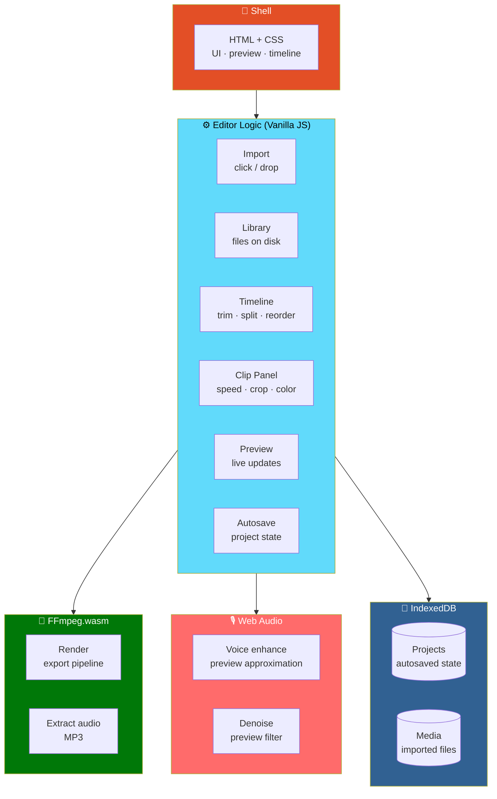

# 🎬 ClipForge

<div align="center">


**A lightweight browser video editor.**

*Trim · Split · Reorder · Speed · Crop · Color grade · Enhance voice · Export — all in the browser*

[🚀 Run](#-run) • [🧪 Test Each Feature](#-test-each-feature) • [🏗️ Architecture](#️-architecture) • [⚠️ Known Limitations](#-known-limitations-not-implemented-yet)

</div>

---

## 📖 Overview

**ClipForge** is a **lightweight browser video editor** built with **HTML, CSS, vanilla JavaScript, FFmpeg.wasm, Web Audio, and IndexedDB**.

### Core Idea

> **Everything happens in the browser.**
>
> **No upload, no account, no server.** Your video never leaves your machine — FFmpeg.wasm does the rendering locally.

### The Editing Flow


---

## 🚀 Run

### 1. Setup

```bash
sh setup.sh
```

**Needs Node/npm** — **copies FFmpeg.wasm into `vendor/`.**

### 2. Serve

```bash
python serve.py
```

**Then open http://localhost:8080 in Chrome or Edge.**

> ⚠️ **Live Server will NOT work for export.**
>
> **FFmpeg.wasm needs COOP/COEP headers** — **which `serve.py` sends.**

---

## 🧪 Test Each Feature

<div align="center">

| Feature | How to Test |
|:--------|-------------|
| **📥 Import** | Click **Import** or **drop files** — then **click a library item** to add it to the timeline |
| **✂️ Trim** | Set **Start** and **End** |
| **✂️ Split** | Move the playhead, **press `S`** |
| **✂️ Delete** | Select a clip, **press `Delete`** |
| **✂️ Reorder** | **Drag clips** |
| **⚡ Speed** | Change the **Speed** control in the Clip panel — **preview updates**, **export applies it** |
| **🔊 Volume** | Change the **Volume** control — **preview updates**, **export applies it** |
| **🖼️ Crop** | Change the **Crop** control — **preview updates**, **export applies it** |
| **🔄 Rotate** | Change the **Rotate** control — **preview updates**, **export applies it** |
| **🔃 Flip** | Change the **Flip** control — **preview updates**, **export applies it** |
| **🎨 Brightness · Contrast · Saturation** | Change the sliders — **preview updates**, **export applies them** |
| **🎵 Extract audio** | Select a clip, click **"Extract audio (MP3)"** |
| **🎙️ Voice enhance** | Set the sliders, **Preview result**, then **export and listen** |
| **💾 Save / Open** | **Save project** *(also autosaves)* · **Projects** to reopen or delete |
| **📤 Export** | Pick settings, **Start export**, then **Download** |

</div>

---

## 🏗️ Architecture

### System Overview



### Design Principles

<div align="center">

| Principle | Implementation |
|-----------|---------------|
| **🔒 Local by architecture** | **FFmpeg.wasm runs in the browser** — **the video never leaves your machine** |
| **🚫 No backend** | **No upload, no account, no server** |
| **🎬 FFmpeg does the rendering** | Export, split, trim, speed, crop, and audio extraction all go through **real FFmpeg** |
| **🎙️ Preview and export are honest about their differences** | Preview uses **filter approximations** — **export uses real FFmpeg filters** *(`afftdn` for denoise)* |
| **💾 Autosave by default** | Project state is saved automatically — **plus explicit Save Project** |
| **🧱 IndexedDB for media and projects** | Large files and autosaved state live in the browser |
| **⚠️ Limitations are stated, not hidden** | Every approximate behavior is documented in **Known Limitations** |

</div>

### 📂 Project Layout

```
clipforge/
├── setup.sh            copies FFmpeg.wasm into vendor/
├── serve.py            static server with COOP/COEP headers
├── vendor/             FFmpeg.wasm
├── index.html          UI shell
├── css/                styles
├── js/                 editor logic
└── README.md
```

---

## ⚠️ Known Limitations *(Not Implemented Yet)*

> **These are stated honestly — not faked.**

<div align="center">

| Feature | Status |
|:--------|:------:|
| **📝 Text overlays / subtitles** | ❌ Not built |
| **🎞️ Transitions** | ❌ Not built |
| **🎵 Audio tracks / background music** | ❌ Not built |
| **📊 Waveforms** | ❌ Not built |
| **✂️ Clip-edge dragging** | ❌ Not built |

</div>

### 📐 Behavioral Limitations

<div align="center">

| Area | Limitation |
|:-----|-----------|
| **🎞️ Timeline** | **One video track** — **clips MUST contain an audio track to export** |
| **🎙️ Preview denoise** | **A filter approximation** — **export uses real FFmpeg `afftdn`** |
| **🎙️ Background reduction** | **A low-pass filter** — **NOT source separation** |
| **🖼️ Preview crop** | **Approximate** — **export uses the FIRST clip's crop ratio for the whole output** |
| **⚡ Performance** | **4K and 60 fps are slow in WASM** — **1080p on long clips may exceed browser memory** |
| **🌐 Browser support** | **Safari / Firefox: preview works — export is best in Chromium browsers** |

</div>

> 💡 **Rather than pretend, ClipForge tells you exactly where the approximations are.**

---

## 🗺️ Roadmap

### ✅ Current

- [x] Vanilla HTML / CSS / JavaScript foundation
- [x] FFmpeg.wasm for in-browser rendering
- [x] Web Audio for preview audio processing
- [x] IndexedDB for projects and media
- [x] `setup.sh` to copy FFmpeg.wasm into `vendor/`
- [x] `serve.py` static server with COOP/COEP headers
- [x] Import by click or drag-and-drop
- [x] Library of imported files
- [x] Click a library item to add it to the timeline
- [x] Trim with Start and End
- [x] Split at the playhead with `S`
- [x] Delete with `Delete`
- [x] Reorder clips by dragging
- [x] Speed control
- [x] Volume control
- [x] Crop control
- [x] Rotate control
- [x] Flip control
- [x] Brightness, contrast, and saturation sliders
- [x] Live preview that reflects all clip edits
- [x] Export applies every clip edit
- [x] Extract audio as MP3
- [x] Voice enhance with sliders and Preview result
- [x] Save project with autosave
- [x] Projects panel to reopen or delete
- [x] Export with configurable settings
- [x] Download the exported file
- [x] Fully local processing — no uploads, no accounts
- [x] Honest documentation of approximations and unimplemented features

### 🔜 Future Ideas

- [ ] **Text overlays and subtitles**
- [ ] **Transitions** between clips
- [ ] **Multiple audio tracks and background music**
- [ ] **Waveform visualization**
- [ ] **Clip-edge dragging** on the timeline
- [ ] **Multi-track timeline** — beyond the single video track
- [ ] **True source separation** for background reduction
- [ ] **Per-clip crop ratio** in export — currently the first clip's ratio applies to all
- [ ] **GPU-accelerated encoding** where supported
- [ ] **Project export/import as a file** — for portability across machines

---

## 🤝 Contributing

Contributions are welcome. Please:

1. Fork the repository
2. **Keep it backend-free** — everything must run in the browser
3. **Keep processing local** — no uploads, no telemetry
4. **Be honest about approximations** — if the preview differs from the export, document it
5. **Preserve COOP/COEP requirements** — document them in any alternative server
6. **Keep `setup.sh` and `serve.py` working** — they're the entry point
7. **Update the Known Limitations section** when you ship a feature that was listed there
8. Test in Chrome and Edge, and note Firefox / Safari differences
9. Submit a Pull Request

### Guidelines

- **Never require a backend** — the editor must work on any static server with the right headers
- **Never claim export works without COOP/COEP** — it doesn't
- **Never present an approximation as the real thing** — preview and export must stay distinguishable
- **Never remove a limitation from the list** without actually fixing it
- **Never add a required external dependency** beyond FFmpeg.wasm

---

## 📜 License

MIT — see [LICENSE](LICENSE) for details.

---

## 🙏 Acknowledgments

- **FFmpeg.wasm** — for making real video processing possible in the browser
- **IndexedDB** — for local storage that can hold actual video files
- **The web platform** — for Web Audio, File API, and everything else this relies on
- **Every creator who's ever needed a quick trim without opening a 500 MB app** — this one's for you

---

<div align="center">

### 🎬 IMPORT. TRIM. ENHANCE. EXPORT.

**A lightweight browser video editor.**

**100% local. No uploads. No accounts.**

<br>

> ⚠️ **Export requires COOP/COEP headers — use `serve.py`, not Live Server.**

<br>

⭐ If ClipForge helped you cut a clip, consider giving it a star.

<br>

[⬆ Back to Top](#-clipforge)

</div>
